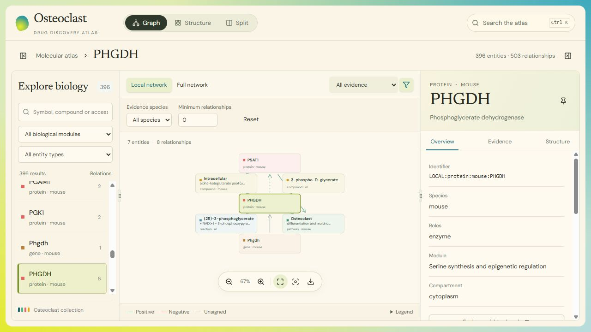

# Osteoclast drug repurposing


A mechanism knowledge graph for exploring osteoclast differentiation and bone resorption, with a React graph/structure viewer and a separate FDA drug-evaluation pipeline.

The canonical dataset contains 396 biological entities, 503 relationship claims, and 518 evidence records. Drug candidates remain outside the biological topology. Evidence review, biological context, and molecular identity are recorded separately. Scores are exploratory heuristics; no trained-model accuracy or validated efficacy prediction is available.

## Pipeline

```mermaid
flowchart TD
    L["Literature and registry snapshots"] --> C["Extract claims and resolve identities"]
    C --> R["Curate evidence and experimental context"]
    R --> K["Canonical biological graph"]
    K --> V["Graph and structure viewer"]
    K --> X["JSON, CSV, Excel and Neo4j exports"]

    F["FDA candidate inventory"] --> M["PubChem / ChEMBL mapping"]
    M --> T["Source-backed drug-target inputs"]
    M --> D["RDKit molecular features"]
    K --> P["Context-aware mechanism paths"]
    T --> P
    P --> E["Grouped assay evaluation pilot"]
    D --> E
    A["Assay outcomes and paper / compound groups"] --> E

    classDef source fill:#dbeafe,stroke:#2563eb,color:#172554
    classDef curation fill:#fef3c7,stroke:#d97706,color:#78350f
    classDef graph fill:#dcfce7,stroke:#16a34a,color:#14532d
    classDef output fill:#ccfbf1,stroke:#0d9488,color:#134e4a
    classDef drug fill:#ede9fe,stroke:#7c3aed,color:#4c1d95
    classDef evaluation fill:#ffe4e6,stroke:#e11d48,color:#881337
    class L,F,A source
    class C,R curation
    class K,P graph
    class V,X output
    class M,T,D drug
    class E evaluation
```

Drug-target inputs overlay the biological graph for analysis. The evaluation pilot prepares grouped inputs and evaluates supplied predictions; model training remains future work.

## Interface



PHGDH neighborhood in the running workbench. Select a relationship for its evidence records, or switch to Structure or Split for molecular inspection.

## Run the viewer

From the repository root:

```powershell
python -m http.server 8765 --bind 127.0.0.1
```

Open [the graph viewer](http://127.0.0.1:8765/index.html). Search for an entity, explore its local network, select a relationship to inspect evidence, then use Structure or Split to inspect available molecular models. Full-network layouts run in a worker and are cached. Large networks initially show the selected entity's connections; All relationships displays every edge.

Compiled assets and local fonts are included. Viewing needs no Node installation or Neo4j database. Remote structure loading needs internet access; 3D rendering needs WebGL. Protein candidates retain their identity qualifications, and computed compound coordinates retain their provenance. See [viewer development](viewer/README.md) and [structure coverage](reports/MOLECULAR_STRUCTURES.md).

## Development and tests

Core graph loading, validation, and export rebuilding use Python's standard library. Install analysis dependencies for registry requests, graph statistics, molecular features, and pilot metrics:

```powershell
python -m pip install -r requirements.txt
python -B -m src.kg.verify_kg
python -B -m unittest discover -s tests -v
```

Optional extraction dependencies are in `requirements-extraction.txt`; the pinned structure-generation environment is in `requirements-structures.txt`. RDKit tests skip when RDKit is unavailable. Structured extraction credentials belong in Windows Credential Manager or `OPENAI_API_KEY`. See [extraction setup](reports/OPENAI_EXTRACTION_SETUP.md).

Frontend development requires Node 22.18+ or Node 24:

```powershell
cd viewer
npm ci
npm test
npm run build
```

The build writes `assets/workbench/`. After changing packaged assets, refresh the checksum manifest from the repository root:

```powershell
python -m src.kg.rebuild --manifest-only
```

## Data and exports

Edit canonical tables in `data/processed`, then rebuild derived artifacts:

```powershell
python -B -m src.kg.rebuild
```

| Table | Contents |
| --- | --- |
| `nodes.csv` | Entity identity, species, molecular form, roles, aliases, and modules |
| `edges.csv` | Directed claims, signs, context references, and causal qualifications |
| `edge_evidence.csv` | Separate supporting or contradicting evidence records for each claim |
| `source_records.csv` | Publication metadata, resolution status, and claim matching |
| `experiments.csv` | Assay details, review status, and structured qualifiers |
| `contexts.csv` | Species, cell type, stage, and other experimental conditions |

Genes, RNA, and proteins have distinct identities. Legacy identifiers resolve through `identifier_map.json` and `legacy_ids`; shared symbols alone do not establish an isoform or orthology mapping. Reaction participation and gene/product mappings remain unsigned.

Rebuilding synchronizes graph JSON, browser data, source ledgers, the [seven-sheet workbook](data/processed/osteoclast_knowledge_graph_sources.xlsx), Neo4j exports, and `data/manifest.json`. It makes no network calls and does not promote review status. Edit CSV inputs, not generated workbooks. Structural validation checks consistency; source verification remains a separate task.

Public-source snapshots and frozen patches support offline replay. Preserve their bytes and hashes. Historical enrichment assertions remain in `data/quarantine/legacy_snapshot.zip`; retired transform entry points fail explicitly. Their implementations remain in Git history.

## Evidence and drug evaluation

Default mechanism analysis accepts source-linked claims under explicit evidence tiers and excludes quarantined or mismatched support. `find_mechanism_paths(..., mode="strict")` requires reviewed experimental support; `mode="discovery"` also permits unresolved source metadata. Unsigned, opposing, and context-incompatible routes remain inspectable. Context-incompatible routes do not contribute to a requested scenario score. See [the evidence policy](reports/EVIDENCE_POLICY.md).

The [serine module](reports/serine_module/README.md) follows PHGDH/PSAT1/PSPH through biochemical participants, chromatin, RNA, and phenotype evidence. The [drug-target input](data/drug_targets/targets.csv) records accession/taxon, assay provenance, and transfer assumptions. `python -m src.kg.drug_targets` evaluates exact mappings; `--allow-species-transfer` enables the explicit cross-species scenario. Potency remains assay-specific.

The [FDA inventory](data/fda/README.md) supplies a candidate universe. The [evaluation pilot](data/evaluation/drug_pilot_v1/README.md) combines PubChem/ChEMBL mappings, RDKit features, assay outcomes, and compound/scaffold/paper grouping. Unknown outcomes are not negative labels. The small retrospective pilot needs independent review and a larger evaluation population before predictive accuracy can be established.

## Repository map

| Path | Purpose |
| --- | --- |
| `src/ingest/` | Cached literature discovery, registry resolution, and staged extraction |
| `src/kg/` | Evidence assessment, path search, curation patches, evaluation, and exports |
| `src/enrichment/` | Workbook and compound-model generation; retired compatibility entry points |
| `schemas/` | Entity, claim, context, and extraction schemas |
| `viewer/` | React/shadcn source, local font licenses, and frontend tests |
| `src/visualization/` | HTML shells and browser-data export |
| `data/` | Canonical tables, provenance, candidates, evaluation inputs, and staging |
| `reports/` | Scientific limits, curation findings, and historical results |
| `neo4j/` | Optional database loader, exports, and queries |
| `tests/` | Python regression tests |

For database inspection, follow the [Neo4j guide](neo4j/README.md). Import into a fresh database or review existing contents before resetting it.

Further details: [biological audit](reports/biological_validation/README.md), [schema/provenance repair](reports/SCHEMA_AND_PROVENANCE_REPAIR.md), [identity quality pass](reports/RESOLUTION_QUALITY_PASS.md), [PHGDH curation](reports/PHGDH_MODULE_CURATION.md), [dasatinib example](reports/single_drug_demo/dasatinib.md), [extraction framework](reports/CLAIM_EXTRACTION_FRAMEWORK.md), and [historical iterations](reports/history/).
